

  <picture>
    <source media="(prefers-color-scheme: dark)" srcset="docs/assets/banner-dark.svg">
    <source media="(prefers-color-scheme: light)" srcset="docs/assets/banner-light.svg">
    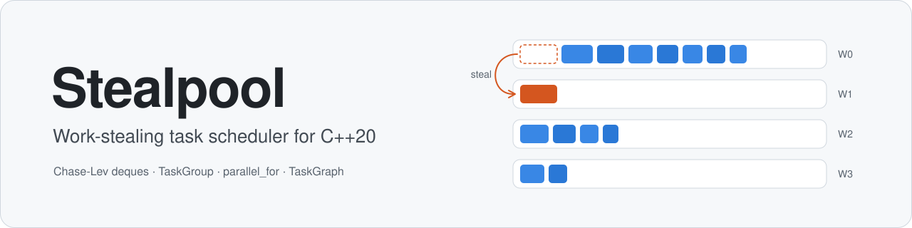
  </picture>

  
  
  
  
  

<h3 align="center">Every worker owns a lock-free deque. Idle workers steal. Waiting workers help.</h3>

  <a href="#at-a-glance"><b>At a glance</b></a> &nbsp;·&nbsp;
  <a href="#how-it-works"><b>How it works</b></a> &nbsp;·&nbsp;
  <a href="#benchmarks"><b>Benchmarks</b></a> &nbsp;·&nbsp;
  <a href="#correctness"><b>Correctness</b></a> &nbsp;·&nbsp;
  <a href="docs/GETTING_STARTED.md"><b>Getting started</b></a> &nbsp;·&nbsp;
  <a href="docs/DESIGN.md"><b>Design notes</b></a>

 

Stealpool is a thread pool for fork-join and dependency-graph workloads. Each worker keeps its own
Chase-Lev deque, so the common case (push a child task, pop it back) never takes a lock. A worker that
runs dry steals the oldest task from a random busy worker, which is usually the largest piece of work left.

On top of the pool sit `submit()` with typed handles, `TaskGroup` for fork-join, `parallel_for`, and
`TaskGraph` for jobs whose steps depend on each other. The library is about 2,100 lines of C++20 and needs
nothing beyond the standard library and threads.

<table>
  <tr>
    <td align="center" width="25%" valign="top">
      <h3 align="center">6.3–10.8×</h3>
      faster than a shared-queue pool on fine-grained tree traversal at 8–16 threads
    </td>
    <td align="center" width="25%" valign="top">
      <h3 align="center">15–84×</h3>
      lower task-scheduling overhead than the shared-queue pool at 8–16 threads
    </td>
    <td align="center" width="25%" valign="top">
      <h3 align="center">28–59 M</h3>
      push, pop and steal operations in one ThreadSanitizer stress run, zero reports
    </td>
    <td align="center" width="25%" valign="top">
      <h3 align="center">314</h3>
      CTest entries passing in Debug, ASan + UBSan and TSan builds
    </td>
  </tr>
</table>

## At a glance

Each card is one claim, with the code that implements it and the test or measurement behind it.

<table>
  <tr>
    <td width="33%" valign="top">
      <b>A lock-free deque per worker</b> 
      The owner pushes and pops its newest task at the bottom with no lock. Thieves take the oldest task from the top with one compare-and-swap. The ring grows on demand and never frees memory a thief might still read.  
      <a href="include/stealpool/deque.hpp"><code>deque.hpp</code></a> · 14 tests in <a href="tests/deque_test.cpp"><code>deque_test.cpp</code></a>
    </td>
    <td width="33%" valign="top">
      <b>Idle workers steal from busy ones</b> 
      A worker with nothing to do starts at a random victim and tries every other worker once. After a lost race it retries the same victim, so a contended deque is never mistaken for an empty one and work is not left behind.  
      <a href="src/thread_pool.cpp"><code>thread_pool.cpp</code></a> · <code>IdleWorkersStealFromABlockedWorker</code>
    </td>
    <td width="33%" valign="top">
      <b>Checked under ThreadSanitizer</b> 
      Randomized, seed-reproducible stress suites ran 28.1 M deque operations on macOS and 59.3 M on Linux under TSan. Every pushed item was taken exactly once, and no data race was reported.  
      <a href="tests/deque_stress_test.cpp"><code>deque_stress_test.cpp</code></a> · <a href="tests/pool_stress_test.cpp"><code>pool_stress_test.cpp</code></a>
    </td>
  </tr>
  <tr>
    <td width="33%" valign="top">
      <b>Measured against a fair baseline</b> 
      The baseline pool shares the tasks, waits, idle policy and pop order; only its single locked queue differs. At 8–16 threads, small tasks ran 6–84× faster with stealing, while coarse parallel sort stayed within 14%.  
      <a href="#benchmarks">Benchmarks</a> · <a href="docs/BENCHMARKS.md"><code>BENCHMARKS.md</code></a>
    </td>
    <td width="33%" valign="top">
      <b>Task dependencies as a graph</b> 
      <code>TaskGraph</code> starts a step only after all of its inputs finish, using one atomic counter per node. A failure skips exactly the steps that depend on it. Graphs are checked for cycles and can be run again.  
      <a href="include/stealpool/task_graph.hpp"><code>task_graph.hpp</code></a> · 62 tests · <a href="examples/pipeline_graph.cpp"><code>pipeline_graph.cpp</code></a>
    </td>
    <td width="33%" valign="top">
      <b>Nested fork-join without deadlock</b> 
      A worker waiting on its children keeps running queued tasks instead of blocking. Nested fork-join therefore finishes even on a single worker, as long as a task waits only on its own children (see the helping rule below). This is tested with recursive Fibonacci, quicksort and a 300-deep chain of nested groups.  
      <a href="tests/task_group_test.cpp"><code>task_group_test.cpp</code></a> · <code>NestedForkJoinTest</code>
    </td>
  </tr>
</table>

## How it works

### A worker's life cycle

A worker always looks for work in the same order: its own deque, then the other workers' deques, then the
injection queue that holds tasks submitted from outside the pool. It parks only after 32 rounds of yield and
retry, so a short gap between tasks costs a yield, not a trip through the kernel.

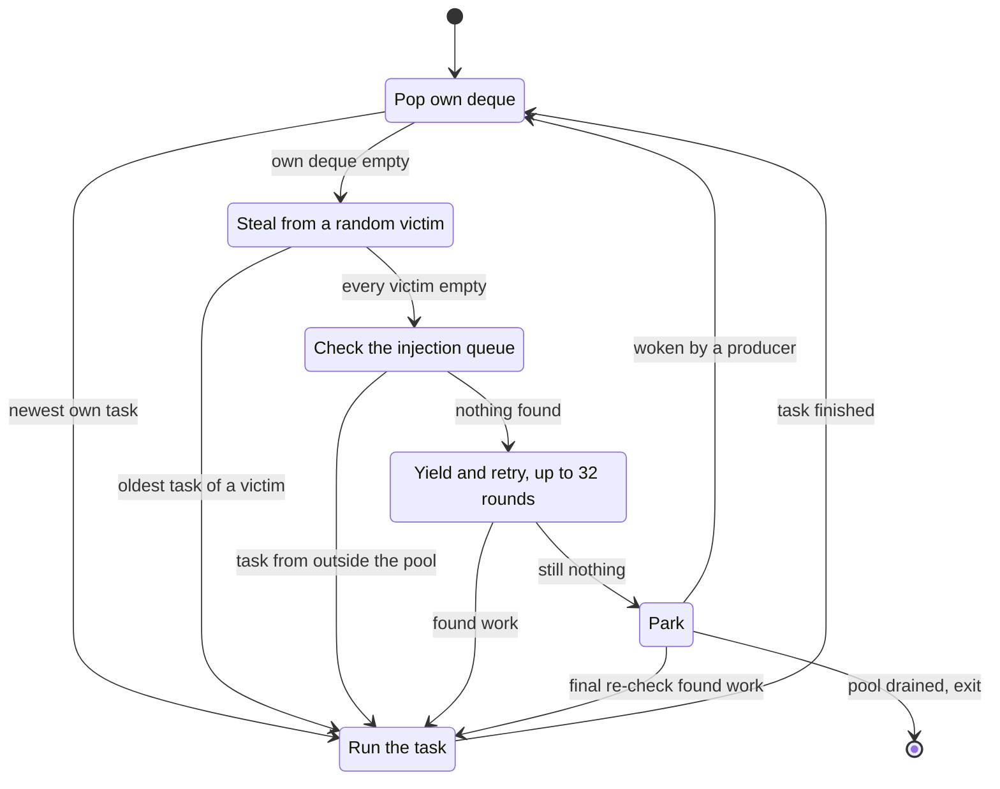

Tasks spawned by a worker go onto its own deque, so most of the time a worker never leaves the first state.
A task is one heap object with a single function pointer. The queues move raw pointers, and no
`std::function` is involved.

### Two ends, two roles

Each deque is used from both ends. The owner pushes and pops at the **bottom** (newest first), while thieves
take from the **top** (oldest first).

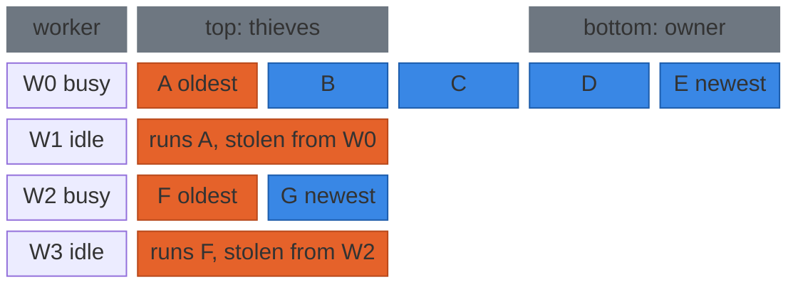

In a divide-and-conquer computation the newest task is the smallest and the most likely to still be in
cache, so the owner works depth-first on hot data. The oldest task sits closest to the root of the
recursion, so one steal moves a large piece of work and thieves come back rarely.

### The Chase-Lev deque and its memory orderings

The deque follows Chase and Lev (2005) with the C++11 memory-model treatment of Lê et al. (2013). It is a
ring of atomic slots plus two 64-bit indices. Only the owner writes `bottom`, and thieves advance `top` with
a compare-and-swap. `top`, `bottom` and the ring pointer each sit on their own 128-byte line, which is the
line size on Apple silicon and the pair size of the x86 adjacent-line prefetcher.

The only real conflict is over the **last element**. `pop` lowers `bottom` and then reads `top`, while
`steal` reads `top` and then `bottom`. All four accesses are `seq_cst`, so in their single total order at
least one side sees the other. When exactly one element is left, both go through the same CAS on `top`,
and exactly one of them wins.

The paper's version uses standalone `seq_cst` fences instead. ThreadSanitizer does not model fences, so a
fence-based deque would either raise false reports or hide real ones. Putting `seq_cst` on the index
accesses keeps the TSan results meaningful and costs little: on AArch64 a `seq_cst` store is the same
`stlr` as a release store, and on x86 the `seq_cst` store in `pop` becomes the `xchg` the fence would have
cost anyway.

Two smaller choices close the remaining gaps:

- **Slots are relaxed atomics.** After the ring wraps, a thief can read a slot the owner is overwriting.
  Its CAS on `top` then fails and the value is thrown away, and the atomic slot makes that race well defined.
- **Old rings are retired, never freed.** Growth doubles the ring, copies the live range and publishes the
  new ring with a release store that thieves acquire. Older rings stay alive until the deque is destroyed,
  so no hazard pointers or epochs are needed, and the retired memory is bounded by the final ring size.

<b>Every ordering in the deque, and why</b>

 

| Operation | Ordering | Why |
|:--|:--|:--|
| `push`: load `bottom` | relaxed | only the owner writes it |
| `push`: load `top` | acquire | pairs with a thief's successful CAS, so a stolen slot is safe to reuse |
| `push`: store slot | relaxed | published by the `bottom` store that follows |
| `push`: store `bottom + 1` | seq_cst | publishes the slot; also the store half of the parking handshake |
| `pop`: store `bottom - 1` | seq_cst | store-to-load ordering with the next `top` load (the Dekker pattern against `steal`) |
| `pop`: load `top` | seq_cst | the other half of that pattern |
| `pop`: CAS `top` on the last element | seq_cst, relaxed on failure | owner and thieves race through the same CAS; exactly one wins |
| `pop`: restore `bottom` | release | keeps every `bottom` store a release, because C++20 release sequences no longer include plain stores by the same thread |
| `steal`: load `top`, then `bottom` | seq_cst, seq_cst | mirror of `pop`; the `bottom` load also acquires the owner's slot write |
| `steal`: load ring pointer | acquire | pairs with the release store in `grow()`, so copied slots are visible |
| `steal`: CAS `top` | seq_cst, relaxed on failure | claims the element; on failure the value read is discarded |
| slot load and store | relaxed | ordered by the index and ring-pointer accesses around them |

Source: [`include/stealpool/deque.hpp`](include/stealpool/deque.hpp), with the full argument in
[`docs/DESIGN.md`](docs/DESIGN.md#memory-ordering).

### Helping waits: why waiting on child tasks does not deadlock

When code running on a worker waits (`TaskGroup::wait`, `TaskHandle::get`, `RunHandle::wait`), the worker
does not block. It keeps finding and running tasks in the same order as its main loop until the awaited
event is set. A thread outside the pool blocks on a parker instead.

The child a worker waits for is either still in that worker's own deque, so the worker pops and runs it
itself, or already running on another worker, which will finish it. Depth-first fork-join therefore always
makes progress, even on a pool with a single worker. Tests cover recursive Fibonacci, quicksort, an
unbalanced tree and a 300-deep chain of nested groups on 1, 2, 3 and 8 workers.

Helping has one rule, which the headers spell out. A helping worker runs unrelated tasks on its own stack,
so a task must not wait on another task's *continuation* or hold a lock across `wait()`. Doing so can
deadlock the pool even while other workers are idle.

### Parking without lost wakeups

The classic bug goes like this: a worker finds every queue empty, a producer pushes a task and sees no
sleeper, and then the worker goes to sleep with work waiting. Stealpool closes that window with a
handshake in which every step is `seq_cst`:

1. The sleeper announces itself by incrementing `sleepers`, reads the wake `epoch`, and checks every queue
   once more.
2. The producer publishes its task (the deque's `bottom` store or the injection count) and then reads
   `sleepers`.
3. In the single total order, either the producer sees the announcement or the sleeper's re-check sees the
   task. A producer that sees a sleeper bumps the epoch under the sleep mutex and wakes **one** parked
   worker. A sleeper whose epoch changed before it reached the mutex does not park at all.

While every worker is busy, `sleepers` is zero and producers never touch the mutex. One subtle case needed
its own fix. A waiting worker could be woken by its own finished event while a producer was spending its
single wakeup on it, which would strand the producer's task. A worker that finds it was removed from the
idle list therefore searches for work once more. The regression test
`TaskGroupTest.WakeupSpentOnAwakeWaiterIsNotLost` covers this case.

### Task dependencies

`TaskGraph` lets a caller describe a multi-step job as a graph and run it on any pool. The diamond below
is the shape used in the tests and in the usage example in [Getting started](docs/GETTING_STARTED.md).

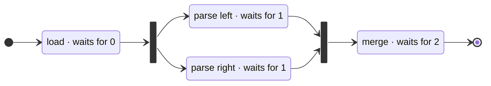

- **Counters, not locks.** Each node stores its number of inputs, and every run resets a per-node atomic
  counter to it. A finishing node decrements each successor's counter (`acq_rel`), and the thread that brings
  a counter to zero schedules that successor itself. On a work-stealing pool the successor lands on that
  thread's own deque, so it likely runs on the same core with its inputs still in cache.
- **Nodes are tasks.** Each node is a task object owned by the graph and kept after it runs. A run
  allocates no task objects, and the same graph can run again with different data.
- **Failures skip exactly the dependents.** The first exception is kept, and every transitive dependent of
  a failed node is skipped. Independent branches still run, and `wait()` rethrows once the whole run has
  settled.
- **Cycles are rejected before anything runs.** `run()` checks for cycles with Kahn's algorithm whenever the
  graph changed, and throws `GraphCycleError`.

### The baseline: one shared queue

`SharedQueuePool` exists only to be measured against. It implements the same executor interface, so the
benchmark code runs unchanged on both pools, and it differs from `ThreadPool` only in its queue. One
`std::deque` behind one `std::mutex` is shared by every worker and submitter.

Everything else is deliberately the same: the task objects, helping waits, 32 yield rounds before a
targeted park, drain-on-shutdown, and even the pop order. A worker takes its own newest queued task first
and otherwise the oldest task, which is what `ThreadPool` would do if all its deques were merged into one.
Simpler orders let helping waits nest so deeply that a recursive `fib(20)` crashed its workers, as
[`docs/DESIGN.md`](docs/DESIGN.md#sharedqueuepool-benchmark-baseline) records, so the baseline is not a
strawman.

## Benchmarks

Both pools run the same fork-join code from [`bench/workloads.hpp`](bench/workloads.hpp) under Google
Benchmark, at 1 to 16 threads, with every result checked for correctness.

| Workload | What it does | Work per task |
|:--|:--|:--|
| Parallel sort | merge sort of 10,000,000 random `int`s, with a parallel merge | coarse: `std::sort` and `std::merge` below 8,192 elements |
| Tree, default | reduction over an unbalanced random tree of 2,097,152 nodes | coarse: at least 256 nodes × 64 mixing rounds |
| Tree, fine-grained | the same tree and seed with `--tree_cutoff=32 --tree_work=16` | about 32× less work per task |
| Task overhead | a binary fork-join tree of 65,535 empty tasks | none: pure spawn, queue, run, join |

> [!NOTE]
> All numbers come from one fanless Apple M5 machine (10 cores: 4 performance + 6 efficiency) running a
> desktop session, not an idle server. macOS runs use Apple clang 21. Linux runs use g++ 13.3 in a Docker
> VM on the same machine, limited to 10 CPUs. Each point is the median of 5 repetitions with both pools
> randomly interleaved. Two full passes per platform were run, and both are reported in
> [`docs/BENCHMARKS.md`](docs/BENCHMARKS.md).

  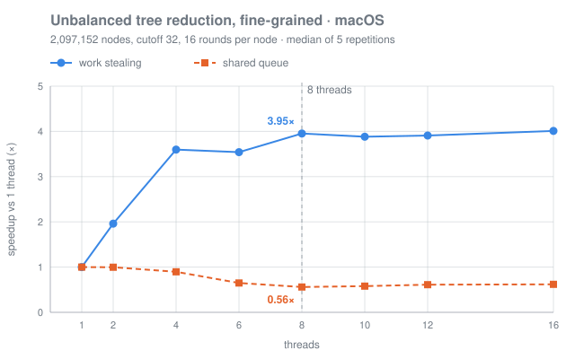
  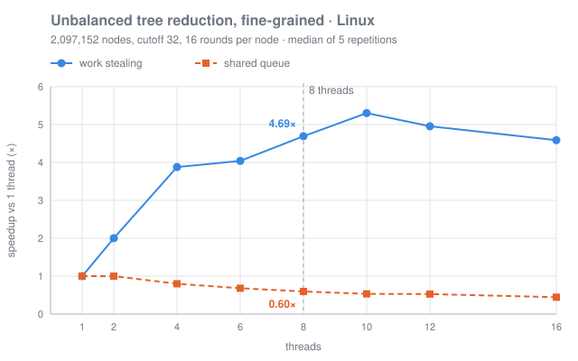

Speedup over the same pool on one thread, first pass, with the dashed line at 8 threads. Small tasks make the shared queue's lock the bottleneck: adding threads makes it <i>slower</i> than one thread.

### Shared-queue time ÷ work-stealing time

Values above 1 mean work stealing is faster. The four thread columns are the first pass. The range column
covers both passes at 8–16 threads.

| Workload | Platform | 8 | 10 | 12 | 16 | Both passes | Verdict |
|:--|:--|--:|--:|--:|--:|:--:|:--|
| Tree, fine-grained | macOS | 7.17 | 6.81 | 6.49 | 6.58 | 6.31–7.17 | **large win** |
| Tree, fine-grained | Linux | 7.87 | 9.96 | 9.39 | 10.31 | 7.85–10.83 | **large win** |
| Task overhead | macOS | 17.66 | 17.21 | 16.25 | 15.01 | 15.01–21.54 | **large win** |
| Task overhead | Linux | 24.39 | 34.76 | 47.26 | 84.22 | 24.39–84.22 | **large win** |
| Parallel sort | macOS | 1.07 | 1.10 | 1.06 | 1.07 | 1.00–1.14 | small edge, ranges overlap |
| Parallel sort | Linux | 1.03 | 0.99 | 1.09 | 0.98 | 0.96–1.13 | within noise |
| Tree, default | macOS | 1.01 | 1.03 | 1.04 | 1.02 | 1.01–1.06 | within noise |
| Tree, default | Linux | 0.99 | 1.04 | 0.98 | 1.06 | 0.98–1.06 | within noise |

  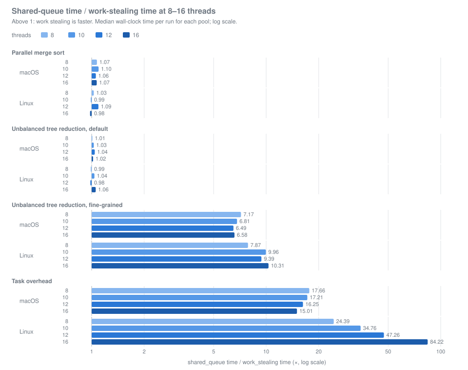

### What the numbers say

- **Work stealing wins big when tasks are small.** On the fine-grained tree and on raw task overhead, every
  shared-queue `schedule()` and pop takes the same mutex, and added workers mostly add lock traffic. Even
  the slowest work-stealing repetition beat the fastest shared-queue repetition by at least 4.9× (macOS) and
  6.5× (Linux) on the fine tree.
- **With coarse tasks the queue does not matter.** Parallel sort and the default tree do so much work per queue
  operation that one mutex is not a bottleneck at 10 cores. Both pools hit the same ceiling, about 5.5–6.4×
  on the default tree and 6.4–7.7× on sort. Differences under about 10% there are within the spread of the
  repetitions.
- **Locality does not explain the gap.** The baseline uses the same own-newest-first order, so both pools
  get depth-first, cache-friendly execution. What remains is the cost of one shared lock and container
  against a lock-free push and pop on a private deque.
- **Mixed core types flatten both curves.** Sort reaches 3.90× at 4 threads (the number of performance
  cores), then only 7.72× at 10 threads. Oversubscription at 12 and 16 threads barely moves work stealing,
  because idle workers yield and then park instead of spinning.

<b>Speedup charts for the other workloads</b>

 

  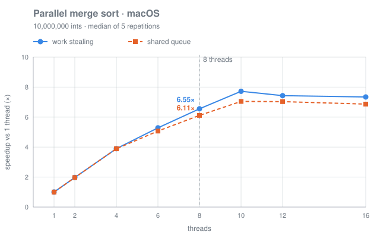
  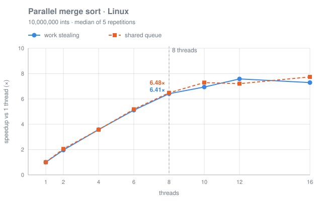

  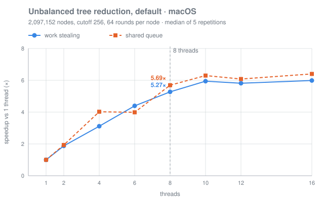
  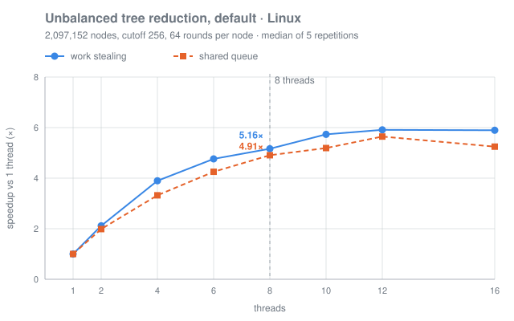

  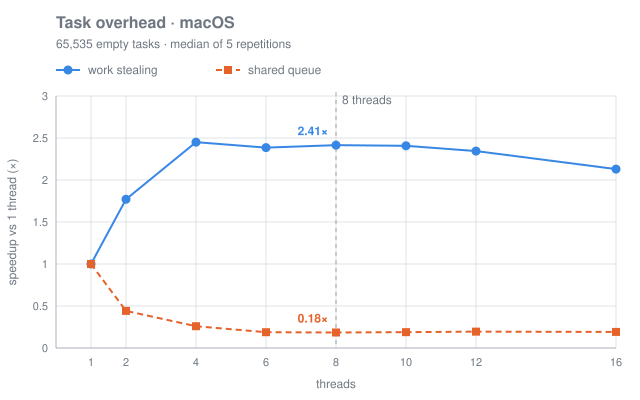
  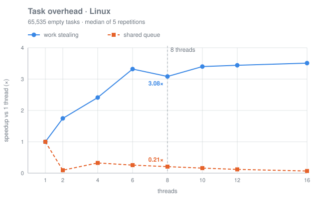

<b>Methodology and caveats</b>

 

- Each pool is built outside the timed loop, and the root of each computation runs inside the pool, so
  every wait is a helping wait. Time is wall-clock. Speedup compares each pool with itself on one thread.
- Each workload ran as its own process with a 45 s pause between workloads. Google Benchmark's random
  interleaving shuffled every repetition of both pools and all thread counts. The second pass ran the
  workloads in reverse order.
- The fine-grained tree setting was fixed before any results were looked at. With the defaults, each task
  carries so much work that the benchmark mostly measures the hardware ceiling.
- The Linux numbers come from a VM on the same Apple M5, not separate x86 hardware. Thread counts above 10
  oversubscribe the machine on purpose.
- The machine is fanless, and the second pass ran slower than the first at most points. The ratios between
  the pools moved much less than the times did.
- One point is unexplained and reported as measured: on Linux, the shared queue at exactly 2 threads takes
  about 20 ms for task overhead in both passes, slower than at 4 threads.
- Raw results: [`bench/results/`](bench/results) (JSON and Markdown for all 16 runs, both passes). The
  charts are regenerated from them by [`scripts/plot_scaling.py`](scripts/plot_scaling.py).

## Correctness

The stress suites are randomized but reproducible: every random choice comes from one base seed, and every
failure prints the derived seed. Each deque item is a pointer whose plain, non-atomic payload is written
just before `push`, so any missing happens-before edge between a push and a steal shows up in
ThreadSanitizer as a data race. Every item must end up taken exactly once, with the right payload.

| Deque scenario | Pushes | Operations, macOS TSan | Operations, Linux TSan |
|:--|--:|--:|--:|
| Random owner program against 1, 2, 4 and 7 thieves (12 runs) | 3,000,000 | 18,427,296 | 43,661,796 |
| Last-element races: owner and thieves meet in the CAS (3 runs) | 450,000 | 3,707,850 | 10,069,522 |
| Ring growth while thieves steal (4 runs) | 800,000 | 2,850,284 | 2,548,762 |
| Mesh: every thread is both owner and thief (3 runs) | 1,400,000 | 3,075,082 | 2,970,367 |
| **Total per run** | **5,650,000** | **28,060,512** | **59,250,447** |

Operations = pushes + pop attempts + steal attempts, as printed by <a href="tests/deque_stress_test.cpp"><code>deque_stress_test</code></a> with the default seed. macOS: Apple clang 21. Linux: g++ 13.3 in the <code>stealpool-dev</code> container. In every scenario, pops plus steals equal pushes. Attempt counts depend on thread timing and vary from run to run.

The pool-level suite in the same runs drives 844,356 random task-tree nodes, 160,302 tasks in reused groups
that throw, 824,832 uneven `parallel_for` iterations, 571,953 tasks from concurrent external submitters,
and 200 pools destroyed while their work was still growing.

| Platform and compiler | Debug | ASan + UBSan | TSan | Release |
|:--|:--:|:--:|:--:|:--:|
| macOS 26 (arm64), Apple clang 21 | ✅ 314 / 314 | ✅ 314 / 314 | ✅ 314 / 314 | ✅ 316 / 316 |
| Linux, Ubuntu 24.04 (aarch64), g++ 13.3 | ✅ 314 / 314 | ➖ | ✅ 314 / 314 | ✅ benchmark smoke 2 / 2 |
| Linux, Ubuntu 24.04 (aarch64), clang 18.1 | ➖ | ➖ | ✅ 314 / 314 | ➖ |

CTest entries: 299 unit tests, 10 stress tests and 5 example runs, plus 2 benchmark smoke checks in Release. ➖ means that configuration was not run. Every build uses <code>-Wall -Wextra -Wpedantic</code> and finishes with zero warnings.

<b>What the 309 GoogleTest cases cover</b>

 

| Test binary | Cases | Covers |
|:--|--:|:--|
| [`deque_test`](tests/deque_test.cpp) | 14 | LIFO and FIFO ends, growth across many resizes and after wrap-around, random operations against a model, the last element contested by 1 and 3 thieves |
| [`thread_pool_test`](tests/thread_pool_test.cpp) | 29 | `submit` and handles, exceptions through `get`, exactly-once on 1–8 workers, external waits, idle workers stealing from a blocked one, cross-pool waits |
| [`task_group_test`](tests/task_group_test.cpp) | 33 | reuse, self-spawning groups, nested fork-join on 1, 2, 3 and 8 workers, exception policy, the lost-wakeup regression |
| [`parallel_for_test`](tests/parallel_for_test.cpp) | 125 | 120 parameterized coverage cases (workers × sizes × grains), empty and reversed ranges, nested loops, uneven costs |
| [`task_graph_test`](tests/task_graph_test.cpp) | 62 | chains, diamonds, fan-out and fan-in, random DAGs up to 20,000 nodes, failure skipping, re-runs, cycles, concurrent graphs |
| [`shared_queue_pool_test`](tests/shared_queue_pool_test.cpp) | 28 | the baseline's API, its pop order, and all three benchmark workloads checked on both pools |
| [`shutdown_test`](tests/shutdown_test.cpp) | 8 | drain-on-destruction: every scheduled task, and everything it spawns, runs before the destructor returns |
| [`deque_stress_test`](tests/deque_stress_test.cpp) | 4 | the four scenarios in the table above |
| [`pool_stress_test`](tests/pool_stress_test.cpp) | 6 | random task trees, reused groups with exceptions, uneven loops, mixed submitters, shutdown races, cross-pool waits |

## Getting started

Stealpool builds with CMake 3.25 or newer (for the presets), Ninja and a C++20 compiler (tested with Apple
clang 21, g++ 13.3 and clang 18.1). CMake fetches GoogleTest and Google Benchmark at pinned versions. The
library itself is a static target, `stealpool::stealpool`, that another CMake project can pull in with
`add_subdirectory`.

| Preset | Build type | Use it for |
|:--|:--|:--|
| `debug` | Debug | everyday development and the full test suite |
| `asan` | RelWithDebInfo, ASan + UBSan | memory errors and undefined behaviour |
| `tsan` | RelWithDebInfo, ThreadSanitizer | data races; run with the `stress` label for the long suites |
| `release` | Release | examples, benchmarks and the benchmark smoke check |

> [!TIP]
> Every command — build, test, sanitizers, stress seeds, examples, a minimal usage program, benchmarks,
> chart regeneration and the Linux container — is in **[docs/GETTING_STARTED.md](docs/GETTING_STARTED.md)**.

## Project layout

| Path | What lives there |
|:--|:--|
| [`include/stealpool/deque.hpp`](include/stealpool/deque.hpp) | `WorkStealingDeque<T>`, the Chase-Lev deque |
| [`include/stealpool/thread_pool.hpp`](include/stealpool/thread_pool.hpp), [`src/thread_pool.cpp`](src/thread_pool.cpp) | `ThreadPool`: worker loop, stealing, parking, helping waits |
| [`include/stealpool/executor.hpp`](include/stealpool/executor.hpp) | the `Executor` interface, `submit()` and `TaskHandle<R>` |
| [`include/stealpool/task_group.hpp`](include/stealpool/task_group.hpp) | `TaskGroup` for fork-join |
| [`include/stealpool/parallel_for.hpp`](include/stealpool/parallel_for.hpp) | `parallel_for` and `parallel_for_blocked`, by recursive range splitting |
| [`include/stealpool/task_graph.hpp`](include/stealpool/task_graph.hpp) | `TaskGraph`, `GraphTask`, `RunHandle` (header-only) |
| [`include/stealpool/shared_queue_pool.hpp`](include/stealpool/shared_queue_pool.hpp), [`src/shared_queue_pool.cpp`](src/shared_queue_pool.cpp) | `SharedQueuePool`, the benchmark baseline |
| [`include/stealpool/detail/task.hpp`](include/stealpool/detail/task.hpp) | the task header, the parker and the one-word completion event |
| [`examples/`](examples) | Fibonacci, quicksort, unbalanced tree sum and a sharded pipeline graph |
| [`tests/`](tests) | GoogleTest unit and stress suites |
| [`bench/`](bench) | the Google Benchmark scaling suite and every published result |
| [`scripts/`](scripts) | benchmark runner, report generator and chart generator (standard-library Python) |
| [`docs/`](docs) | [design notes](docs/DESIGN.md), [benchmark report](docs/BENCHMARKS.md), [getting started](docs/GETTING_STARTED.md) |
| [`docker/Dockerfile`](docker/Dockerfile) | the Ubuntu 24.04 image (`stealpool-dev`) used for Linux builds and runs |

## Limitations

- **Helping runs other tasks on the waiter's stack.** Stack depth can exceed the program's own recursion
  depth, and a task must not wait on another task's continuation or hold a lock across `wait()`.
- **One waiter per handle.** A `TaskHandle` or `RunHandle` supports one waiting thread at a time.
- **External work can be delayed.** The injection queue is checked after stealing, so a computation that
  keeps generating local work can hold back tasks submitted from outside the pool.
- **One heap allocation per task.** There is no per-worker free list.
- **Graphs are built on one thread** and run one at a time per graph. Running out of memory while
  scheduling a ready successor terminates the program, because tasks are `noexcept`.
- **Shutdown rules.** While a pool's destructor runs, scheduling onto it from an outside thread, or being
  inside a wait on one of its handles or groups, is undefined behaviour. Destroying a pool from one of its
  own workers is asserted against.
- **Not measured.** Per-core utilisation was not recorded, so "keeps every core busy" rests on the scaling
  results and the stealing tests, not on a utilisation trace. Results come from one machine.
- **No install rules.** Consume it with `add_subdirectory`, and switch off its tests, examples and
  benchmarks as shown in the getting-started guide.

## References

1. David Chase and Yossi Lev. *Dynamic Circular Work-Stealing Deque.* SPAA 2005.
2. Nhat Minh Lê, Antoniu Pop, Albert Cohen and Francesco Zappa Nardelli. *Correct and Efficient
   Work-Stealing for Weak Memory Models.* PPoPP 2013.
3. Robert D. Blumofe and Charles E. Leiserson. *Scheduling Multithreaded Computations by Work Stealing.*
   Journal of the ACM 46(5), 1999.

 

Stealpool · C++20 · <a href="docs/DESIGN.md">Design notes</a> · <a href="docs/BENCHMARKS.md">Benchmark report</a> · <a href="#readme-top">Back to top ↑</a>

